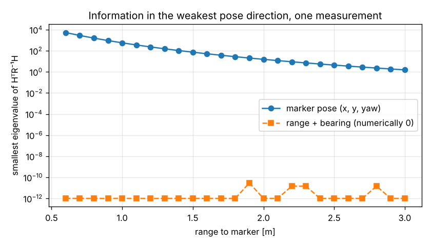
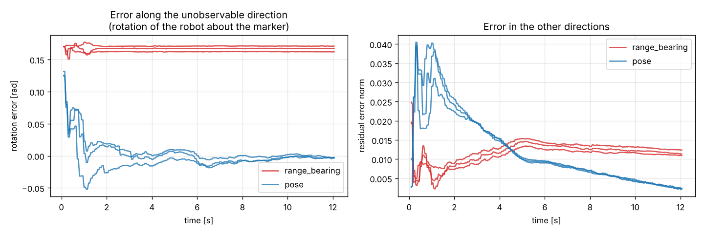
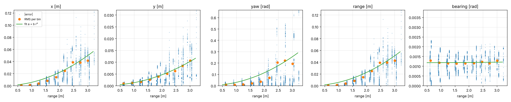
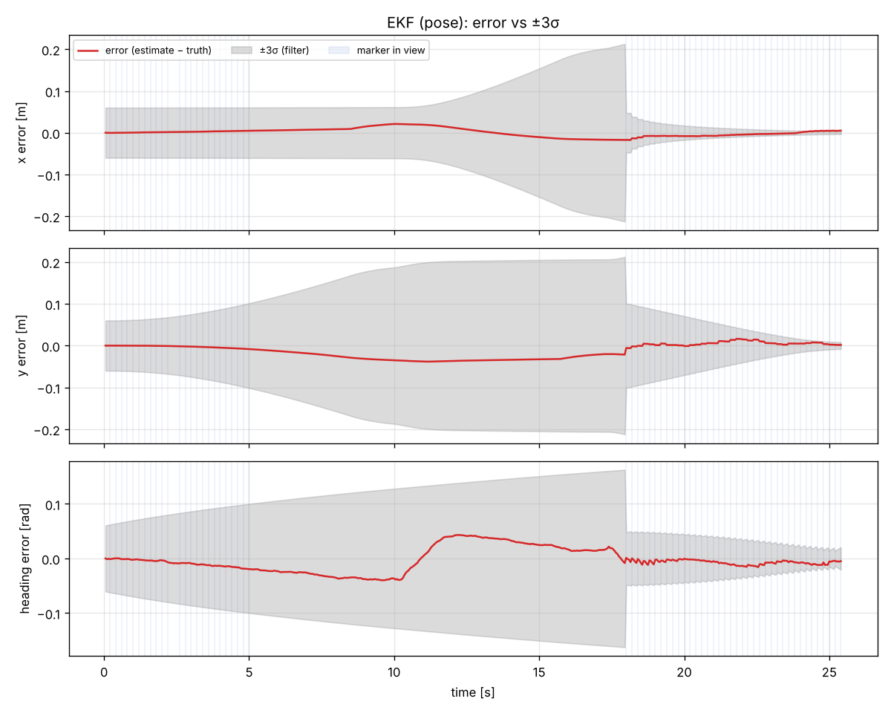
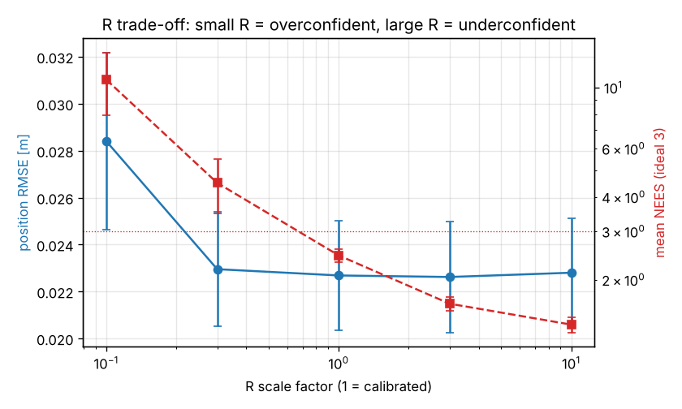

# TurtleBot3 Visual Waypoint Navigation and ArUco Docking

**41014 Sensors and Control in Mechatronics, Integrated Project, Track A**

| | |
|---|---|
| **Group** | _Group 99_ |
| **Members** | _Muhammad Suhaib Khan (1351525)_, _Jaden Gambrill(26065197)_, _Siale Smythe (24831226)_ |
| **Track** | A: mobile robot, visual waypoint navigation (MuJoCo) |
| **Hardware** | _Simulation only_ |
| **Demo video** | _[link, 5 min]_ |

---

## 1. Overview

_The robot navigates a room with obstacles using 2D LiDAR, then visually docks to the ArUco-marked charging station. An EKF fuses wheel-encoder odometry with camera measurements of the marker (range/bearing or pose). A state-feedback/LQR tracker acts on the **estimated** state only._

_Insert pipeline block diagram: sensors → EKF → planner → LQR → MuJoCo, with ground truth branching to the evaluator only._

## 2. Quick start

Requires Python 3.10+.

```bash
git clone https://github.com/<org>/<repo>.git
cd <repo>
python -m venv .venv
source .venv/bin/activate          # Windows: .venv\Scripts\activate
pip install -r requirements.txt

python scripts/build_scene.py      # generate models/scene.xml from the config
python -m pytest                   # model checks + ground-truth policy
python scripts/sensor_check.py     # encoders, LiDAR, camera and ArUco working
python scripts/dead_reckoning.py   # open-loop odometry drift vs truth
python scripts/run.py              # closed loop with the EKF (add --estimator dr for the baseline)
python scripts/analyse_model.py    # Part A controllability/observability
python scripts/ekf_study.py        # Part C repeated trials and R trade-off
python scripts/run.py --view       # same, with the 3D viewer (macOS: use mjpython)
```

Figures are written to `results/`. All tunable values are in `configs/nominal.yaml`.

Tested on: _OS, Python version, MuJoCo version_.

## 3. Repository layout

```
configs/          YAML configs: robot, sensors, noise, obstacles, waypoints, gains
models/           Generated MuJoCo scene and ArUco texture (rebuild with build_scene.py)
src/
  model/          Differential-drive model, linearisation, observability/controllability
  sensing/        Wheel odometry, LiDAR, ArUco detection and range/bearing
  frames/         SE(2) helpers and sensor mounts (world, base_link, camera, marker)
  estimation/     Dead-reckoning baseline, EKF
  planning/       Waypoint follower, obstacle avoidance from LiDAR
  control/        Go-to-goal baseline, LQR tracker
  sim/            MuJoCo interface. Exposes sensor readings ONLY.
evaluation/       Ground truth access, metrics, plots. NEVER imported by src/
scripts/          Entry points: build_scene, sensor_check, dead_reckoning, run
tests/            Unit tests, including the ground-truth policy check
results/          Logged runs and generated figures
docs/             Images, frame diagram, derivations
```

> **Ground truth policy.** Simulator ground truth is read only in `evaluation/ground_truth.py`. The planner and controller receive the estimate only. `tests/test_no_ground_truth.py` fails if any module under `src/` imports from `evaluation/` or reads the simulator's true pose or velocity.

### Current status

| Component | Status | Lead |
|---|---|---|
| Simulation scene, sensors | Working | _name_ |
| Wheel odometry, dead reckoning | Working (baseline) | _name_ |
| Model, Jacobians, controllability/observability | Done | _name_ |
| ArUco detection, range/bearing | Working, nominal intrinsics (calibration TODO) | _name_ |
| Go-to-goal controller, waypoints | Working (baseline) | _name_ |
| EKF (pose model, calibrated Q/R, gating) | Done | _name_ |
| LQR tracker | TODO: `src/control/lqr.py` | _name_ |
| LiDAR obstacle avoidance | TODO: `src/sensing/lidar.py` | _name_ |
| Visual docking, evaluation matrix | TODO | _name_ |

## 4. Modelling (Part A)

Full derivations and discussion: [`docs/part_A_C_notes.md`](docs/part_A_C_notes.md). Code: `src/model/diff_drive.py`, analysis: `scripts/analyse_model.py`.

- **State** x = [x, y, θ]ᵀ (base_link in world). **Input** u = [v, ω]ᵀ.
- **Continuous model** (differential drive): ẋ = v cos θ, ẏ = v sin θ, θ̇ = ω, with v = r(ω_R+ω_L)/2, ω = r(ω_R−ω_L)/b, **r = 0.033 m, b = 0.160 m** (TurtleBot3 Burger).
- **Discrete odometry model** (Δt = 0.05 s, midpoint rule, m = θ + Δθ/2): x⁺ = x + Δs cos m, y⁺ = y + Δs sin m, θ⁺ = θ + Δθ, driven by encoder increments Δs, Δθ.
- **Jacobians** F = ∂f/∂x and G = ∂f/∂[Δs, Δθ], derived by hand and verified against finite differences in `tests/test_model.py`.
- **Assumptions:** planar motion, no slip, known r and b, kinematic (velocity-controlled wheels settle in ~0.3 s). Slip and radius error appear as odometry drift and are absorbed in Q.
- **Controllability** of the linearised tracking-error model (A(v_r, ω_r), B): rank 3 whenever the reference moves, **rank 2 at rest** (no sideways motion, nonholonomic); σ_min falls as v_r → 0.
- **Observability:**

| Measurements | Rank of observability matrix |
|---|---|
| Odometry only | 0: absolute pose unobservable, drift unbounded |
| Range + bearing to one marker (any motion) | **2**: rotation of the robot about the marker, null vector [dy, −dx, 1], is never observable |
| Marker pose (x, y, yaw) | **3** from a single measurement |

The pose model is therefore used. Observability weakens with range (yaw noise ∝ r²): one measurement constrains the weakest direction to ~1.4 cm at 0.6 m but ~80 cm at 3 m.



Verified experimentally: starting 0.15 rad wrong along the rotation direction, the range+bearing EKF never corrects it (+0.17 rad after 12 s, 3 seeds); the pose EKF corrects it to < 0.004 rad within ~2 s.



## 5. Sensing and calibration (Part B)

- **Sensors:** _encoders (rate, resolution), LiDAR (range, FOV, rate), camera (resolution, FOV, rate)_
- **Camera intrinsics:** _how obtained, values_
- **Noise characterisation:** _method (e.g. static logging), measured σ for each sensor_
- **ArUco detection:** _dictionary, marker size, detection range limits_
- **Frame diagram:** _figure of world, odom, base_link, camera, marker frames, with transform values_

## 6. Estimation (Part C)

Code: `src/estimation/ekf.py`. Discussion of every choice: [`docs/part_A_C_notes.md`](docs/part_A_C_notes.md).

- **Filter:** EKF on [x, y, θ]. Predict at 20 Hz from encoder increments (P ← FPFᵀ + GQGᵀ); update at up to 5 Hz from the ArUco marker pose in base_link; Joseph-form covariance update; angle innovations wrapped.
- **Measurement model:** h(x) = [Rᵀ(θ)(m − p); θ_m − θ], H derived by hand, finite-difference tested.
- **Q (process noise):** per-wheel variance q0 + k|d|, propagated to [Δs, Δθ]. Fitted to step residuals, then scaled ×10.3 so predict-only NEES = 3 (the per-step fit misses time-correlated errors such as wheel-radius bias). **q0 = 8.6e-8 m², k = 4.5e-7 m.** (`scripts/calibrate_odometry_noise.py`)
- **R (measurement noise):** calibrated from 3147 detections at 135 known poses; σ(r) = a + b r² per component, e.g. depth 5.6 mm at 1 m → 5.0 cm at 3 m, yaw 0.03 → 0.25 rad. Readings beyond the calibrated 3 m are ignored. (`scripts/calibrate_marker_noise.py`)



- **Outliers:** χ² gate at 99 % (NIS > 11.34 rejected); after 5 consecutive rejections P is inflated ×100 (divergence recovery, see failure analysis).
- **Marker loss:** predict-only; covariance grows with distance travelled and collapses at the next reading:



**Results** (5 seeds, closed loop): see Section 8.

## 7. Control (Part D)

- **Controller:** _LQR on tracking error / state feedback_
- **Weights / gains:** _Q_lqr, R_lqr values and how they were chosen_
- **Limits:** _velocity and acceleration saturation, effect on tracking_
- **Docking approach:** _final-approach strategy, tolerance_

## 8. Results (Parts C, D, E)

### Estimation (Part C), 5 seeds, mean ± std

| Condition | Pos. RMSE [m] | Final pos. error [m] | Mean NEES (ideal 3) | Rejected / run |
|---|---|---|---|---|
| Dead reckoning | 0.056 ± 0.004 | 0.149 ± 0.008 | – | – |
| EKF range+bearing | 0.023 ± 0.002 | 0.005 ± 0.000 | 2.25 ± 0.13 | 0.0 |
| EKF pose, R ×0.1 | 0.028 ± 0.004 | 0.010 ± 0.006 | 10.68 ± 2.73 | 13.0 |
| **EKF pose, calibrated R** | **0.023 ± 0.002** | **0.007 ± 0.002** | **2.45 ± 0.13** | **1.4** |
| EKF pose, R ×10 | 0.023 ± 0.002 | 0.006 ± 0.000 | 1.37 ± 0.09 | 0.0 |

The EKF reduces final position error ~20× vs dead reckoning. Underestimating R makes the filter overconfident (NEES 10.7) and it rejects genuine readings; overestimating makes it underconfident.



### Nominal case (full pipeline)
| Metric | Value |
|---|---|
| Position RMSE (estimate vs truth) | 0.023 m |
| Heading RMSE | 0.022 rad |
| Tracking error (RMS) | _m (Part D)_ |
| Docking final error | _m, rad (Part D)_ |
| Docking success rate | _x / N_ |

### Robustness (repeated trials, varied conditions)
| Condition | Trials | Success | Est. RMSE | Track RMSE | Notes |
|---|---|---|---|---|---|
| Nominal | | | | | |
| 2× sensor noise | | | | | |
| Marker occlusion | | | | | |
| Wheel slip / bias | | | | | |
| Varied start pose | | | | | |
| External push | | | | | |

### Trade-offs
_e.g. R scaling vs. NEES and responsiveness; LQR weight ratio vs. control effort and tracking error._

### Failure analysis

**Gate lockout (estimator).** The first EKF was worse than dead reckoning (final error 18 cm vs 15 cm, 37 of 62 updates rejected). Logging every innovation showed that marker readings from 4.3–4.8 m, beyond the calibrated range, were biased ~15 cm in depth but accepted; they shifted the estimate ~10 cm and shrank P, after which correct close-range readings had NIS 30–45 and were all gated out. Fix: ignore readings beyond the calibrated range and add divergence recovery. Result: final error 0.5 cm, NEES 2.5.

**Unobservable direction (model).** Range+bearing cannot correct initial error along the rotation about the marker (Part A); the pose measurement model fixes this.

_Other components: add failures here._

## 9. Hardware (optional)

_Setup, differences from simulation, quantitative sim-vs-hardware comparison._

## 10. Limitations and future work

_What the results do and do not support._

## 11. Individual contributions

| Member | Led | Contributed to |
|---|---|---|
| Muhammad Suhaib Khan (1351525) | Part A (modelling), Part C (EKF) | Project page, repository setup |
| Jaden Gambrill (26065197) | Part B (sensing), simulation environment | |
| Siale Smythe (24831226) | Part D (control) | |

## 12. Generative AI declaration

| Tool | Purpose | Where used |
|---|---|---|
| _e.g. Claude_ | _e.g. README structure, debugging help_ | _e.g. README, src/estimation_ |

## 13. References

_Tutorials, papers, libraries used._
