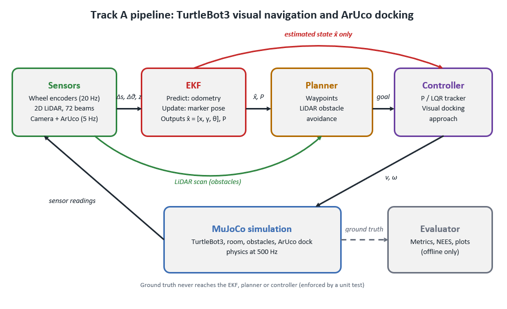
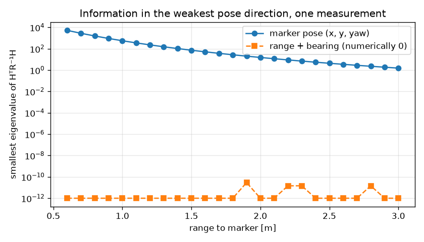
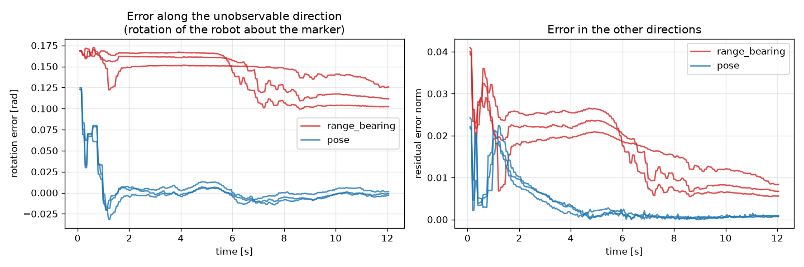
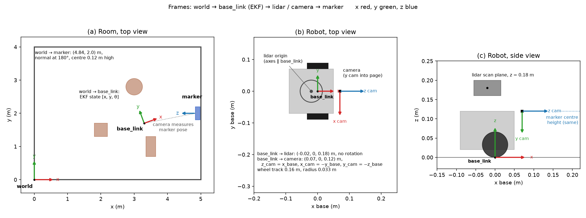
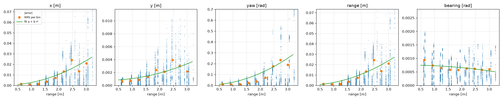
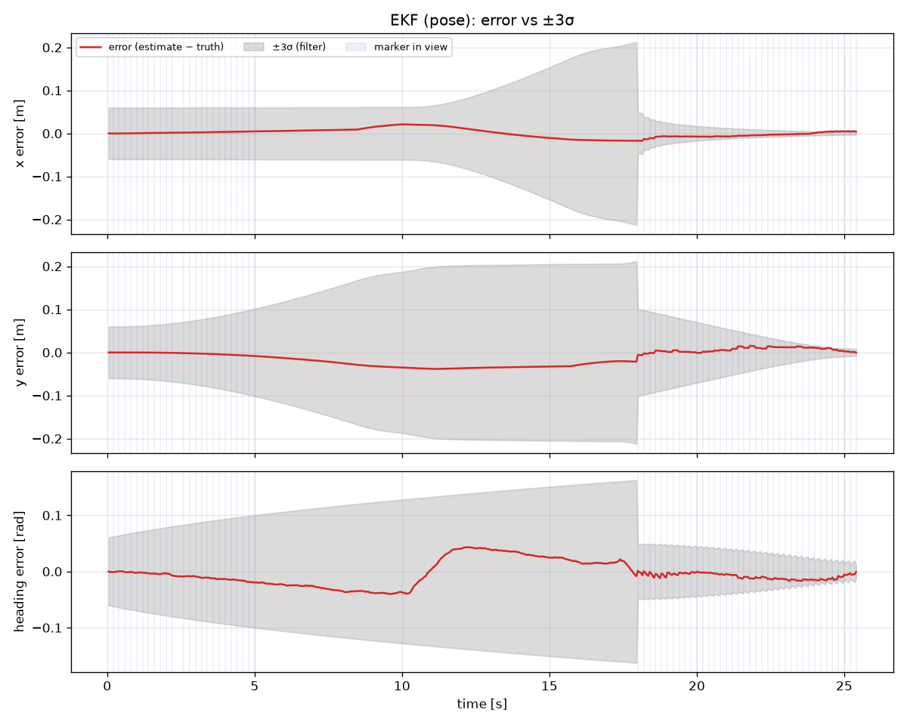
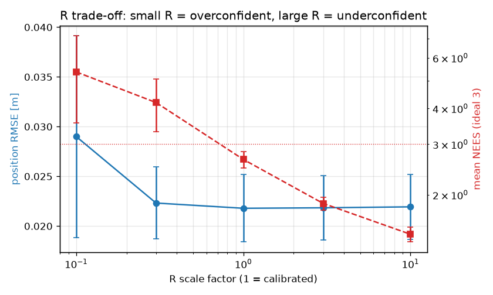
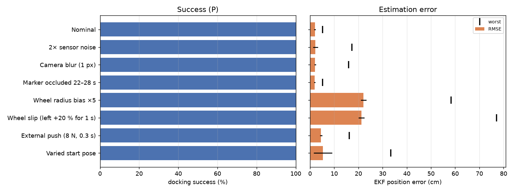

# TurtleBot3 Visual Waypoint Navigation and ArUco Docking

**41014 Sensors and Control in Mechatronics, Integrated Project, Track A**

| | |
|---|---|
| **Group** | _Group 99_ |
| **Members** | _Muhammad Suhaib Khan (1351525)_, _Jaden Gambrill(26065197)_, _Siale Smythe (24831226)_ |
| **Track** | A: mobile robot, visual waypoint navigation (MuJoCo) |
| **Hardware** | _Simulation only_ |
| **Demo video** | _[link, 5 min]_ |

---

## 1. Overview

_The robot navigates a room with obstacles using 2D LiDAR, then visually docks to the ArUco-marked charging station. An EKF fuses wheel-encoder odometry with camera measurements of the marker (range/bearing or pose). A state-feedback/LQR tracker acts on the **estimated** state only._

   

## 2. Quick start

Requires Python 3.10+.

```bash
git clone https://github.com/<org>/<repo>.git
cd <repo>
python -m venv .venv
source .venv/bin/activate          # Windows: .venv\Scripts\activate
pip install -r requirements.txt

python scripts/build_scene.py      # generate models/scene.xml from the config
python -m pytest                   # model checks + ground-truth policy
python scripts/sensor_check.py     # encoders, LiDAR, camera and ArUco working
python scripts/dead_reckoning.py   # open-loop odometry drift vs truth
python scripts/run.py              # closed loop with the EKF, then visual docking (--no-dock to stop at the last waypoint)
python scripts/dock_study.py       # docking over 5 seeds, scored against ground truth
python scripts/analyse_model.py    # Part A controllability/observability
python scripts/ekf_study.py        # Part C repeated trials and R trade-off
python scripts/run.py --view       # same, with the 3D viewer (macOS: use mjpython)
```

Figures are written to `results/`. All tunable values are in `configs/nominal.yaml`.

Tested on: _OS, Python version, MuJoCo version_.

## 3. Repository layout

```
configs/          YAML configs: robot, sensors, noise, obstacles, waypoints, gains
models/           Generated MuJoCo scene and ArUco texture (rebuild with build_scene.py)
src/
  model/          Differential-drive model, linearisation, observability/controllability
  sensing/        Wheel odometry, LiDAR, ArUco detection and range/bearing
  frames/         SE(2) helpers and sensor mounts (world, base_link, camera, marker)
  estimation/     Dead-reckoning baseline, EKF
  planning/       Waypoint follower, obstacle avoidance from LiDAR
  control/        Go-to-goal baseline, LQR tracker, visual docking
  sim/            MuJoCo interface. Exposes sensor readings ONLY.
evaluation/       Ground truth access, metrics, plots. NEVER imported by src/
scripts/          Entry points: build_scene, sensor_check, dead_reckoning, run
tests/            Unit tests, including the ground-truth policy check
results/          Logged runs and generated figures
docs/             Images, frame diagram, derivations
```

> **Ground truth policy.** Simulator ground truth is read only in `evaluation/ground_truth.py`. The planner and controller receive the estimate only. `tests/test_no_ground_truth.py` fails if any module under `src/` imports from `evaluation/` or reads the simulator's true pose or velocity.

### Current status

| Component | Status | Lead |
|---|---|---|
| Simulation scene, sensors | Working: independent noise stream per sensor, LiDAR max-range fix, optional camera blur | Jaden |
| ArUco detection, range/bearing | Working: calibrated intrinsics, range-bias correction, edge-dropout fix | Jaden |
| Sensor noise characterisation, frames | Done | Jaden |
| Wheel odometry, dead reckoning | Working (baseline) | Muhammad |
| Model, Jacobians, controllability/observability | Done | Muhammad |
| Go-to-goal controller, waypoints | Working (baseline) | Muhammad |
| EKF (pose model, calibrated Q/R, gating) | Done | Muhammad |
| LQR tracker | Working: `src/control/lqr.py` | Siale |
| LiDAR obstacle avoidance | Working: `src/planning/avoidance.py` | Jaden |
| Visual docking | Working: `src/control/docking.py`, 5/5 seeds | Siale |
| Evaluation matrix | TODO | Jaden |

## 4. Modelling (Part A)

Full derivations and discussion: [`docs/part_A_C_notes.md`](docs/part_A_C_notes.md). Code: `src/model/diff_drive.py`, analysis: `scripts/analyse_model.py`.

- **State** x = [x, y, θ]ᵀ (base_link in world). **Input** u = [v, ω]ᵀ.
- **Continuous model** (differential drive): ẋ = v cos θ, ẏ = v sin θ, θ̇ = ω, with v = r(ω_R+ω_L)/2, ω = r(ω_R−ω_L)/b, **r = 0.033 m, b = 0.160 m** (TurtleBot3 Burger).
- **Discrete odometry model** (Δt = 0.05 s, midpoint rule, m = θ + Δθ/2): x⁺ = x + Δs cos m, y⁺ = y + Δs sin m, θ⁺ = θ + Δθ, driven by encoder increments Δs, Δθ.
- **Jacobians** F = ∂f/∂x and G = ∂f/∂[Δs, Δθ], derived by hand and verified against finite differences in `tests/test_model.py`.
- **Assumptions:** planar motion, no slip, known r and b, kinematic (velocity-controlled wheels settle in ~0.3 s). Slip and radius error appear as odometry drift and are absorbed in Q.
- **Controllability** of the linearised tracking-error model (A(v_r, ω_r), B): rank 3 whenever the reference moves, **rank 2 at rest** (no sideways motion, nonholonomic); σ_min falls as v_r → 0.
- **Observability:**

| Measurements | Rank of observability matrix |
|---|---|
| Odometry only | 0: absolute pose unobservable, drift unbounded |
| Range + bearing to one marker (any motion) | **2**: rotation of the robot about the marker, null vector [dy, −dx, 1], is never observable |
| Marker pose (x, y, yaw) | **3** from a single measurement |

The pose model is therefore used. Observability weakens with range (yaw noise ∝ r²): one measurement constrains the weakest direction to ~1.4 cm at 0.6 m but ~80 cm at 3 m.



Verified experimentally: starting 0.15 rad wrong along the rotation direction, the range+bearing EKF never corrects it (+0.17 rad after 12 s, 3 seeds); the pose EKF corrects it to < 0.004 rad within ~2 s.



## 5. Sensing and calibration (Part B)

Scripts in Quick start; results in `results/`. Ground truth is used only offline, as a surveyed reference.

### Sensors

| Sensor | Simulated as | Rate | Resolution |
|---|---|---|---|
| Wheel encoders | Tick random walk (σ = 1 tick/step), wheel radius error ±0.2 % | 20 Hz | 4096 ticks/rev (0.051 mm) |
| 2D LiDAR | 72 rangefinders, σ = 1 cm | 20 Hz | 5°, 3.5 m max |
| Camera | Pixel noise σ = 8 grey levels | 5 Hz | 640 × 480, 60° × 75° FOV |
| ArUco marker | `DICT_4X4_50`, 0.15 m, centre 0.12 m high | | |

### Frames



camera → base_link (0.07 m forward, 0.12 m up) → world (EKF estimate) ↔ marker (4.84, 2.0 m, facing 180°). LiDAR → base_link (0.02 m behind) via `scan_to_base()`. No separate odom frame: the start pose is known. `tests/test_frames.py` pushes a real scan into the world frame: median 5.3 mm from the walls (12.2 mm if the mount offset is ignored).

### Noise (`characterise_noise.py`)

| | Measured | Predicted |
|---|---|---|
| Encoder distance / step | σ = 0.044 mm | 1 tick = 0.051 mm |
| Encoder heading / step | σ = 4.8 × 10⁻⁴ rad | 4.5 × 10⁻⁴ rad |
| Heading drift (10 seeds) | **−0.024 ± 0.003 rad/m** | **−0.025 rad/m** (radius error) |
| LiDAR | σ = 9.98 mm, bias 0.2 mm | 10 mm |
| Camera range (corrected) | RMS 1.5 mm < 1 m, 3–5 mm at 1–2 m, 17 mm at 2–3 m | |
| Camera bearing | RMS 0.02–0.06° | 1 px = 0.14° |

A single run can be ±13 % off the drift, so encoder figures are averaged over 10 seeds. The drift is a bias, so Q must be inflated above the per-step σ (Part C).

### Camera calibration (`calibrate_camera.py`)

Checkerboard (9 × 6, 40 mm) shown in 160 random poses with camera noise; outlier views rejected.

| | Calibrated (83 views, 0.093 px RMS) | Ideal | Old nominal |
|---|---|---|---|
| f_x, f_y | 415.31, 415.33 (± 0.21) | 415.69 | 415.69 |
| c_x, c_y | **319.30, 239.54** (± 0.2) | 319.5, 239.5 | **320, 240** |
| Distortion | < 0.003 | 0 | 0 |

The old nominal K put the image centre at (320, 240); OpenCV's pixel-centre convention gives (319.5, 239.5). The half-pixel error biased every bearing by 0.069°. One calibration pins c_x to about ±0.25 px, so this halves the bias rather than removing it.

### Marker detection (`detection_envelope.py`)

| Reliable detection (≥ 95 %) | Value |
|---|---|
| Range, head-on | 0.25–4.4 m |
| Bearing off image centre | 15° at 0.3 m, 30° at 1 m, 34° at 2 m |
| View angle off marker normal | 70° at 0.5 m, 60° at 1–2 m |

These set the docking stop distance (0.30 m) and bearing tolerance (Part D).

### Range bias correction (`calibrate_marker_range.py`)

The marker read too far away, growing with distance. Not the intrinsics (identical with either K): ArUco's "L" corners refine inward; checkerboard "X" corners don't. Fitted bias(d) = a₂d² + a₃d³, tested on 120 **held-out** random poses:

| Distance | Bias before → after | RMS before → after |
|---|---|---|
| 1–2 m | +4.9 → +0.3 mm | 7.0 → 4.5 mm |
| 2–3 m | +33.9 → +7.7 mm | 39.2 → 16.4 mm |
| 3–4.5 m | +67.6 → −26.7 mm | 98.3 → 63.7 mm |

Within the EKF's 3 m cut-off the bias is essentially gone; beyond it, pose-to-pose scatter dominates.

### LiDAR obstacle avoidance (`src/planning/avoidance.py`)

Checks a corridor (robot half-width + 12 cm) towards the goal in the scan; if blocked, places a temporary waypoint 0.5 m along the closest clear heading and holds it until reached. Works with both controllers. Routes straight through an obstacle: 0/5 without avoidance (stranded by the safety stop), 5/5 with it, ≥ 10 cm body clearance. Start → dock needs no hand-placed waypoints.

### Limitations

- The simulated camera is an exact pinhole, so calibration validates the method but had no distortion to correct.
- The range correction ignores view angle; residual bias is 1.5–2× larger at 20° off the marker normal.
- Results are for nominal noise without blur; blur is a Part E condition.

## 6. Estimation (Part C)

Code: `src/estimation/ekf.py`. Discussion of every choice: [`docs/part_A_C_notes.md`](docs/part_A_C_notes.md).

- **Filter:** EKF on [x, y, θ]. Predict at 20 Hz from encoder increments (P ← FPFᵀ + GQGᵀ); update at up to 5 Hz from the ArUco marker pose in base_link; Joseph-form covariance update; angle innovations wrapped.
- **Measurement model:** h(x) = [Rᵀ(θ)(m − p); θ_m − θ], H derived by hand, finite-difference tested.
- **Q (process noise):** per-wheel variance q0 + k|d|, propagated to [Δs, Δθ]. Fitted to step residuals, then scaled ×10.3 so predict-only NEES = 3 (the per-step fit misses time-correlated errors such as wheel-radius bias). **q0 = 8.6e-8 m², k = 4.5e-7 m.** (`scripts/calibrate_odometry_noise.py`)
- **R (measurement noise):** calibrated from 3147 detections at 135 known poses; σ(r) = a + b r² per component, e.g. depth 5.6 mm at 1 m → 5.0 cm at 3 m, yaw 0.03 → 0.25 rad. Readings beyond the calibrated 3 m are ignored. (`scripts/calibrate_marker_noise.py`)



- **Outliers:** χ² gate at 99 % (NIS > 11.34 rejected); after 5 consecutive rejections P is inflated ×100 (divergence recovery, see failure analysis).
- **Marker loss:** predict-only; covariance grows with distance travelled and collapses at the next reading:



**Results** (5 seeds, closed loop): see Section 8.

## 7. Control (Part D)

- **Controller:** _LQR on tracking error / state feedback_
- **Weights / gains:** _Q_lqr, R_lqr values and how they were chosen_
- **Limits:** _velocity and acceleration saturation, effect on tracking_
- **Docking approach** (`src/control/docking.py`, settings under `docking:` in the config): takes over after the last waypoint and works from marker detections and wheel odometry only, not the EKF or the marker's map pose.
  - *Relative pose.* Each detection gives the marker pose in base_link; inverting it gives the robot pose in the marker frame (x out of the marker face). Between the 5 Hz camera frames this pose is carried forward with the odometry increments.
  - *Approach.* A second LQR tracker (slower: v_ref 0.08 m/s) follows the marker normal from the robot's projection on it to the stop point 0.30 m from the marker. Ending on the normal, facing the marker, centres the marker in the image.
  - *Decision.* Made on fresh detections only: the robot stops on the first frame that reads within 1 cm of the stop distance, and is docked if the marker is then within 10° of the image centre, otherwise the attempt fails (the controller never reverses). If odometry says the stop point is reached, it holds still until a frame confirms it.
  - *Marker loss.* After 2 s without a detection it rotates in place towards the last known bearing; docking gives up after 30 s.
  - *Tolerance.* Success is 0.25–0.35 m from the marker (base_link to marker centre) with the marker within ±15° of the image centre, judged against ground truth in `evaluation/metrics.py`. The 0.30 m target sits above the closest reliable detection range (0.25 m, Part B), and 15° is the bearing limit measured at 0.3 m.

## 8. Results (Parts C, D, E)

### Estimation (Part C), 5 seeds, mean ± std

| Condition | Pos. RMSE [m] | Final pos. error [m] | Mean NEES (ideal 3) | Rejected / run |
|---|---|---|---|---|
| Dead reckoning | 0.056 ± 0.004 | 0.149 ± 0.008 | – | – |
| EKF range+bearing | 0.023 ± 0.002 | 0.005 ± 0.000 | 2.25 ± 0.13 | 0.0 |
| EKF pose, R ×0.1 | 0.028 ± 0.004 | 0.010 ± 0.006 | 10.68 ± 2.73 | 13.0 |
| **EKF pose, calibrated R** | **0.023 ± 0.002** | **0.007 ± 0.002** | **2.45 ± 0.13** | **1.4** |
| EKF pose, R ×10 | 0.023 ± 0.002 | 0.006 ± 0.000 | 1.37 ± 0.09 | 0.0 |

The EKF reduces final position error ~20× vs dead reckoning. Underestimating R makes the filter overconfident (NEES 10.7) and it rejects genuine readings; overestimating makes it underconfident.



### Nominal case (full pipeline)
| Metric | Value |
|---|---|
| Position RMSE (estimate vs truth) | 0.023 m |
| Heading RMSE | 0.022 rad |
| Tracking error (RMS) | 2.7 cm (P), 3.0 cm (LQR) |
| Docking final range | 0.311 ± 0.001 m (target 0.30 m, allowed 0.25–0.35 m) |
| Docking final image bearing | 0.09 ± 0.07° (allowed ±15°) |
| Docking success rate | 5 / 5 |

Position and heading RMSE are for the route only, as in the Part C study (`ekf_study.py` runs with docking off). Docking figures are from `python scripts/dock_study.py` (5 seeds, P controller on the route):

| Route controller | Success | Final range [m] | Image bearing [°] | Lateral offset [cm] | Heading error [°] | Docking time [s] |
|---|---|---|---|---|---|---|
| P | 5/5 | 0.311 ± 0.001 | +0.09 ± 0.07 | 0.0 ± 0.1 | −0.01 ± 0.07 | 5.6 ± 0.1 |
| LQR | 5/5 | 0.310 ± 0.001 | −0.03 ± 0.05 | −0.1 ± 0.1 | −0.09 ± 0.12 | 5.7 ± 0.0 |

The robot stops about 1 cm beyond the target because it stops on the first frame inside the 1 cm tolerance; this is well inside the allowed band. Its own camera reading at the stop agrees with truth to 2–3 mm. During docking the EKF's χ² gate rejected 5 of the close-range (≈0.3 m) marker readings on seed 0 (NIS 15–58, none consecutive enough to trigger recovery) and mean NEES over the full run rose from 2.4 to 5.6: R appears too small at this range. Docking does not use the EKF, and the estimate stayed within 7 mm of truth.

### Robustness (Part E)

Full mission (LiDAR navigation, then visual docking), nominal config plus **one** change per row, 5 seeds each. `python scripts/robustness_study.py [--controller lqr]`.

| Condition | Docked (P / LQR) | Est. RMSE P / LQR [cm] | Worst est. error P / LQR [cm] | NEES P / LQR |
|---|---|---|---|---|
| Nominal | 5/5 · 5/5 | 2.0 / 3.0 | 5 / 18 | 8.0 / 6.3 |
| 2× sensor noise | 5/5 · 5/5 | 2.2 / 3.1 | 17 / 24 | 10.5 / 7.2 |
| Camera blur (1 px) | 5/5 · 5/5 | 2.1 / 3.5 | 16 / 31 | 7.1 / 9.0 |
| Marker occluded 22–28 s | 5/5 · 5/5 | 2.0 / 2.7 | 5 / 13 | 9.8 / 3.5 |
| Wheel radius bias ×5 | 5/5 · 5/5 | 22.1 / 20.5 | 58 / 51 | 36.3 / 21.2 |
| Wheel slip (left +20 %, 1 s) | 5/5 · 5/5 | 21.2 / 16.3 | 77 / 46 | 37.2 / 13.2 |
| External push (8 N, 0.3 s) | 5/5 · 5/5 | 4.6 / 3.0 | 16 / 12 | 9.8 / 7.8 |
| Varied start pose | 5/5 · 5/5 | 5.3 / 3.0 | 33 / 18 | 8.2 / 5.0 |



**80/80 docked.** Noise, blur, occlusion and pushes barely affect the mission. Odometry faults (wheel bias, slip) are the weak point: see failure analysis.

### Trade-offs

**P vs LQR:** P finishes in 31 s vs 44 s and is slightly more accurate nominally (2.0 vs 3.0 cm), but LQR degrades more gracefully under odometry faults (worst error under slip 46 vs 77 cm, NEES 13 vs 37).

### Failure analysis

**Gate lockout (estimator).** The first EKF was worse than dead reckoning (final error 18 cm vs 15 cm, 37 of 62 updates rejected). Logging every innovation showed that marker readings from 4.3–4.8 m, beyond the calibrated range, were biased ~15 cm in depth but accepted; they shifted the estimate ~10 cm and shrank P, after which correct close-range readings had NIS 30–45 and were all gated out. Fix: ignore readings beyond the calibrated range and add divergence recovery. Result: final error 0.5 cm, NEES 2.5.

**Unobservable direction (model).** Range+bearing cannot correct initial error along the rotation about the marker (Part A); the pose measurement model fixes this.

**Overconfident EKF after odometry faults (integration).** With wheel bias ×5 or slip the EKF error reaches 50–77 cm (NEES ≈ 35), yet every trial still docks. Cause: from ~3 s to 19 s no marker reading is usable (beyond the 3 m cut-off, then out of view), so the EKF runs on odometry alone; Q only covers the nominal ±0.2 % wheel error, so P stays small while the error grows. When the marker returns, the χ² gate rejects the correct readings (19 rejections). The divergence recovery (P inflated after 5 rejections) then accepts them and the error falls below 1 cm within 6 s. Weak points: single-marker coverage, and Q tuned for nominal conditions only.

**Coupled sensor noise (simulation).** Enabling camera noise changed odometry drift by 20 %: all sensors shared one random generator. Fixed with one stream per sensor (`tests/test_sim_noise.py`).

**Phantom LiDAR obstacles (simulation).** MuJoCo clamps long beams to 3.5 m instead of returning nothing, making a ring of fake obstacles (13 of 72 beams). Max-range returns are now dropped; worst scan point went from 607 mm to 23 mm off a surface (`tests/test_frames.py`).

**Marker dropouts at the image edge (sensing).** OpenCV's default `minDistanceToBorder = 3 px` rejected fully visible markers. Setting it to 0 widened the usable bearing at 0.3 m from 10° to 15° (`tests/test_aruco.py`).

**Half-pixel principal point and range bias (sensing).** Bearings were offset 0.069° and long-range readings up to 7 cm long; both diagnosed and corrected in Part B.

## 9. Hardware (optional)

_Setup, differences from simulation, quantitative sim-vs-hardware comparison._

## 10. Limitations and future work

_What the results do and do not support._

## 11. Individual contributions

| Member | Led | Contributed to |
|---|---|---|
| Muhammad Suhaib Khan (1351525) | Part A (modelling), Part C (EKF) | Project page, repository setup |
| Jaden Gambrill (26065197) | Part B (sensing) and the simulation enviroment | Repository workflow (branch protection, reviews) |
| Siale Smythe (24831226) | Part D (control) | |

## 12. Generative AI declaration

| Tool | Purpose | Where used |
|---|---|---|
| _e.g. Claude_ | _e.g. README structure, debugging help_ | _e.g. README, src/estimation_ |

## 13. References

_Tutorials, papers, libraries used._
