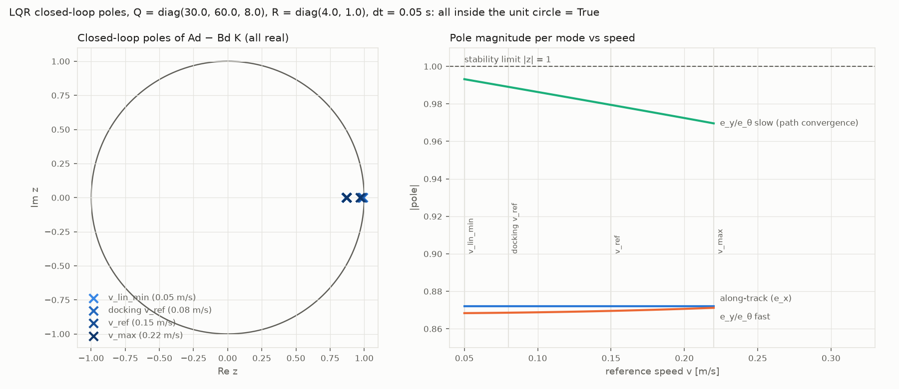
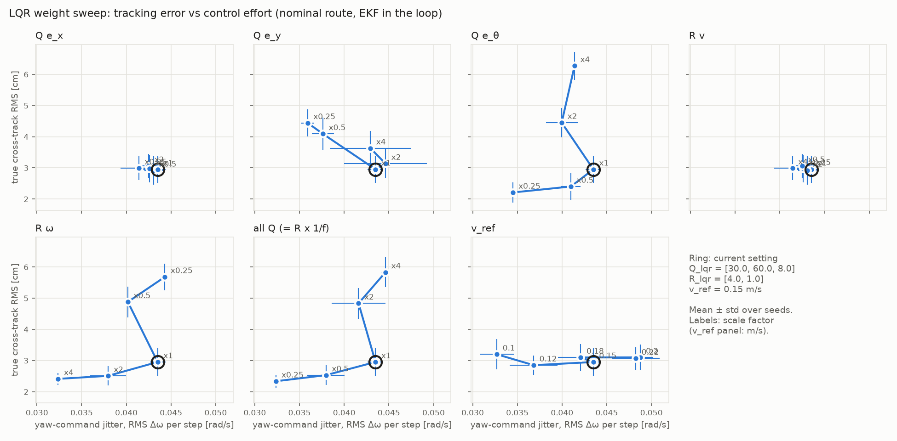

# LQR tracker: weights, reference speed and stability

Controller: `src/control/lqr.py`. Settings: `controller.lqr` in `configs/nominal.yaml`
(Q_lqr = diag(30, 60, 8) on [e_x, e_y, e_θ], R_lqr = diag(4, 1) on [δv, δω], v_ref = 0.15 m/s, dt = 0.05 s).

Every number below comes from one of these scripts (outputs in `results/`, figures in `docs/figures/`):

| Script | Output |
|---|---|
| `scripts/lqr_design_report.py` | gains, poles, `lqr_poles.png`, `results/lqr_design_report.txt` |
| `scripts/compare_controllers.py` | P vs LQR, `results/compare_controllers.md` |
| `scripts/sweep_lqr_weights.py` | weight and v_ref sweep, 20-seed check, `lqr_weight_sweep.png`, `results/sweep_lqr_weights.md` |
| `scripts/sweep_lqr_weights.py --diagnose 10` | cause of the heavier-weight result, `results/sweep_lqr_diagnose.md` |

All runs: nominal route, EKF in the loop, obstacle avoidance on, docking off, scored against ground truth in
`evaluation/metrics.py` (`tracking_metrics`). "Track RMS" is the RMS distance of the **true** path to the
waypoint polyline (start → waypoints). "Jitter" is the RMS step-to-step change of the yaw-rate command.

## 1. What each weight does

The error model linearised about a straight reference (ω_r = 0) splits into two independent parts:

- **Along-track (e_x → δv).** K = [[2.558, 0, 0], …] at every speed. Q_x and R_v only set this one gain, and
  only through their ratio, so "Q_x ×4" and "R_v ×0.25" are the same controller (identical rows in the sweep).
  This mode has a pole at 0.872 (τ = 0.37 s). It regulates the robot's position along the moving reference,
  which is not what the cross-track metric measures, and the sweep shows no measurable effect on tracking
  (2.92–3.07 cm against 2.95 cm, all within one standard deviation).
- **Cross-track and heading (e_y, e_θ → δω).** Q_y, Q_θ and R_ω set the two gains on δω
  (7.149 and 2.993 at v_ref). This part has a fast mode (pole ≈ 0.87, τ ≈ 0.36 s) and a slow
  **path-convergence mode**, whose time constant falls as speed rises:

  | Speed | Slow pole | τ | v·τ |
  |---|---|---|---|
  | v_lin_min 0.05 m/s (also used at v = 0) | 0.9932 | 7.29 s | 0.36 m |
  | docking v_ref 0.08 m/s | 0.9891 | 4.55 s | 0.36 m |
  | v_ref 0.15 m/s | 0.9794 | 2.41 s | 0.36 m |
  | v_max 0.22 m/s | 0.9696 | 1.62 s | 0.36 m |

  A cross-track offset therefore decays over a **fixed distance of about 0.36 m**, whatever the speed. This is
  consistent with the stage-1 docking tests, where a 6 cm offset had only shrunk to about 3.5 cm after the
  0.24 m approach (e^(−0.24/0.36) ≈ 0.51).
- **Only the ratio Q/R sets the gain.** Scaling all of Q by 4 and all of R by 0.25 gives gains equal to
  machine precision (max |ΔK| = 8e-31). It also gives identical 20-seed results.

## 2. Stability

Gains and the closed-loop poles of A_d − B_d K were checked at v = 0 (which uses v_lin_min), v_lin_min,
the docking speed, v_ref and v_max. **All poles are real and inside the unit circle at every speed**; the
largest is 0.9932 at v_lin_min. The slow mode moves towards 1 as the speed falls, which is why the gain is
computed at no less than v_lin_min: at v = 0 the lateral error is uncontrollable.

## 3. P vs LQR (5 seeds)

| Controller | Finished | Route time [s] | Track RMS [cm] | Track max [cm] | Est. track RMS [cm] | RMS ω [rad/s] | ω jitter |
|---|---|---|---|---|---|---|---|
| P | 5/5 | 25.3 ± 0.1 | 2.73 ± 0.21 | 6.4 ± 0.8 | 2.79 ± 0.17 | 0.595 | 0.182 ± 0.000 |
| LQR | 5/5 | 38.5 ± 0.2 | 2.95 ± 0.44 | 8.2 ± 0.3 | 2.17 ± 0.31 | 0.302 | 0.044 ± 0.001 |

The LQR uses half the yaw rate and a quarter of the yaw-command jitter of the P controller. It stays closer to
the route **as the estimator sees it** (2.17 cm vs 2.79 cm), but its true cross-track is the same within noise
and it is 13 s slower (RMS speed 0.135 m/s against 0.206 m/s for P). On this
route the true cross-track is dominated by estimation error (Section 5), not by how well either controller tracks.

## 4. Weight and speed sweep

One-at-a-time scaling: each diagonal entry of Q_lqr and R_lqr scaled by 0.25, 0.5, 2 and 4 with the others
fixed, all of Q scaled together, and v_ref swept from 0.10 to 0.22 m/s. 5 seeds per point.

| Setting | Track RMS [cm] | Est. track RMS [cm] | EKF pos. RMSE [cm] | ω jitter | Route time [s] |
|---|---|---|---|---|---|
| **current** | **2.95 ± 0.44** | 2.17 ± 0.31 | 3.16 ± 0.62 | 0.044 | 38.5 |
| Q_y ×0.25 | 4.44 ± 0.44 | 2.32 ± 0.23 | 4.40 ± 0.65 | 0.036 | 38.2 |
| Q_y ×4 | 3.63 ± 0.56 | 1.66 ± 0.52 | 3.85 ± 0.57 | 0.043 | 37.7 |
| Q_θ ×0.25 | 2.21 ± 0.33 | 1.21 ± 0.03 | 2.26 ± 0.63 | 0.034 | 38.3 |
| Q_θ ×4 | 6.27 ± 0.44 | 2.60 ± 0.07 | 5.20 ± 0.59 | 0.041 | 37.9 |
| R_ω ×4 | 2.41 ± 0.19 | 1.56 ± 0.09 | 2.27 ± 0.56 | 0.032 | 38.7 |
| R_ω ×0.25 | 5.68 ± 0.42 | 2.10 ± 0.10 | 5.34 ± 0.59 | 0.044 | 37.5 |
| all Q ×0.25 | 2.34 ± 0.20 | 1.52 ± 0.06 | 2.26 ± 0.56 | 0.032 | 38.7 |
| all Q ×4 | 5.83 ± 0.48 | 2.12 ± 0.10 | 5.68 ± 0.65 | 0.045 | 37.4 |
| v_ref 0.10 | 3.20 ± 0.48 | 1.74 ± 0.15 | 3.10 ± 0.82 | 0.033 | 54.7 |
| v_ref 0.18 | 3.10 ± 0.44 | 1.92 ± 0.50 | 3.05 ± 0.78 | 0.042 | 32.6 |
| v_ref 0.22 | 3.07 ± 0.36 | 2.16 ± 0.54 | 3.36 ± 0.67 | 0.048 | 28.1 |

Full table: `results/sweep_lqr_weights.md`. Every setting finished the route on every seed.

- **Q_x, R_v:** no effect on tracking (Section 1).
- **Q_y:** the current value is at or near the best; both lower (×0.25: 4.44 cm) and higher (×4: 3.63 cm) are worse.
- **Q_θ and R_ω:** monotonic. A softer heading loop (lower Q_θ, higher R_ω, or all of Q lower) gives lower true
  cross-track **and** lower jitter; a stiffer one gives both higher error and no lower jitter.
- **v_ref:** true cross-track is flat within noise from 0.10 to 0.22 m/s (2.85–3.20 cm), while route time falls
  from 54.7 s to 28.1 s and jitter rises from 0.033 to 0.048.

## 5. Heavier weights: real, and caused by odometry error, not by tracking

Earlier ad hoc runs (3 seeds) gave worse true cross-track with heavier weights (Q ×3: 5.5 cm, R ×0.25: 6.0 cm).
Repeated with 20 seeds:

| Setting | Track RMS [cm] | Est. track RMS [cm] | EKF pos. RMSE [cm] | Total rotation, from `--diagnose` |
|---|---|---|---|---|
| current | 3.06 ± 0.37 | 1.95 ± 0.27 | 2.97 ± 0.56 | 178° |
| all Q ×3 | 5.63 ± 0.47 | 2.02 ± 0.11 | 5.42 ± 0.55 | |
| all R ×0.25 | 6.19 ± 0.48 | 2.22 ± 0.13 | 6.05 ± 0.56 | |
| all Q ×4 | 6.19 ± 0.48 | 2.22 ± 0.13 | 6.05 ± 0.56 | 217° |

**The effect is real**: the difference from the current setting is five to seven times the per-seed standard
deviation, and it appears at 3, 5 and 20 seeds. What the measurements show about its cause:

1. **The controller tracks its estimate equally well.** Estimated-path cross-track is about 2 cm in all four
   settings. What grows is the EKF position error (3.0 → 5.4–6.1 cm), and the true path follows the estimate.
2. **The EKF has no usable marker correction early in the route.** With the EKF and with dead reckoning in
   the loop, the position error at t = 12 s is identical (current 2.45 ± 0.57 cm, Q ×4 4.70 ± 0.67 cm, 10 seeds):
   on the first segment the marker is beyond the 3 m cut-off or outside the camera view, so the estimate there is
   pure odometry.
3. **The extra odometry error comes from the rotations, not the straight driving.** Dead reckoning, 10 seeds:

   | | current | all Q ×4 |
   |---|---|---|
   | straight-line heading drift, 0.3–1.8 m | −1.37 ± 0.27 °/m | −1.37 ± 0.28 °/m |
   | heading error at 0.3 m (start) | +0.01 ± 0.16° | −0.74 ± 0.23° |
   | rotation through corner 1 | 80.2° | 98.3° |
   | heading error change through corner 1 | +1.25 ± 0.33° | −1.43 ± 0.52° |
   | heading error at 3 m | −1.75 ± 0.51° | −5.24 ± 0.64° |
   | position error at 3 m | 4.6 ± 1.1 cm | 11.5 ± 1.2 cm |

   The straight-line drift (the wheel-radius bias, −0.024 rad/m) is the same. The stiffer heading loop rotates
   more: 98° inside the corner-1 window for an 83° change of direction, and 217° over the route against 178°,
   which indicates overshoot and correction in the turns. The odometry heading error picked up during those rotations differs by about 0.75° at the
   start and 2.7° through corner 1, and is then integrated over the next ~2 m before the marker is usable again.

   Not established: *why* odometry error during a rotation depends on how the turn is executed. The per-corner
   change is not simply larger for the stiff controller (through corner 2 it is −2.66° for the current setting
   and +0.15° for Q ×4), so it is not a constant turn-scale error. Wheel–floor contact effects during fast
   rotation transients are a plausible cause; the simulator does show a +0.40 ± 0.06 % turn-scale error that is
   not in the config (`results/noise_characterisation.yaml`), but it was not isolated here.

So on this route, **true cross-track mostly measures how much odometry error the controller's turning
induces before the marker becomes usable**, rather than how tightly it follows the path.

## 6. Why these values, and where the trade-off sits

The current weights predate this sweep. Against the sweep:

- **Q_y = 60** is at the measured optimum for cross-track; halving or doubling it is worse or no better.
- **Q_x = 30, R_v = 4** have no measurable effect on tracking; their ratio only sets how hard the robot
  speeds up or slows down to stay level with the reference point (one pole, τ = 0.37 s).
- **Q_θ = 8, R_ω = 1** sit on the stiff side of the trade-off. On this route a softer heading loop gives lower
  true cross-track and lower jitter, at the cost of more time turning in place (0.081–0.084 of the run against
  0.058) and up to 0.2 s more route time.
- **v_ref = 0.15 m/s** is a speed/smoothness compromise: accuracy is flat across 0.10–0.22 m/s, time falls
  with speed, jitter rises. At v_ref = v_max = 0.22 m/s, the forward command is clipped at v_max, so the
  along-track loop can no longer speed up to catch the reference.

**Candidate changes (not applied; config unchanged in this stage):**

| Candidate | Track RMS [cm] | ω jitter | Turn-in-place fraction | Route time [s] |
|---|---|---|---|---|
| current | 2.95 ± 0.44 | 0.044 | 0.058 | 38.5 |
| Q_θ = 2 (×0.25) | 2.21 ± 0.33 | 0.034 | 0.081 | 38.3 |
| R_ω = 4 (×4) | 2.41 ± 0.19 | 0.032 | 0.084 | 38.7 |
| all Q ×0.25 | 2.34 ± 0.20 | 0.032 | 0.084 | 38.7 |
| v_ref = 0.18 | 3.10 ± 0.44 | 0.042 | 0.069 | 32.6 |

These are 5-seed results on the nominal route only. Before adopting one: repeat with 20 seeds, and re-run the
docking study (`docking.lqr` inherits Q_lqr and R_lqr from `controller.lqr`), the obstacle-avoidance test and
the robustness study (push and slip recovery), since a softer heading loop converges more slowly
(Section 1: the path-convergence distance would grow).
